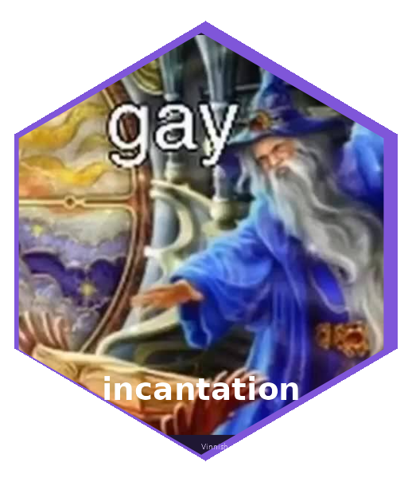
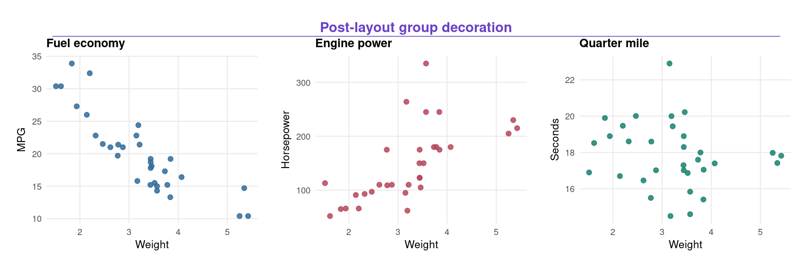
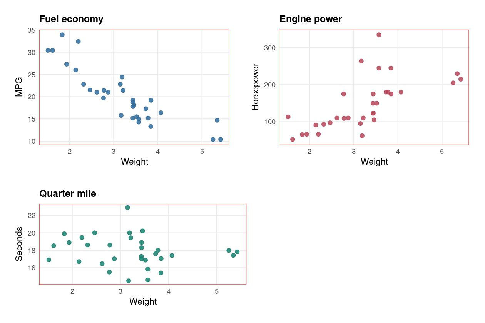
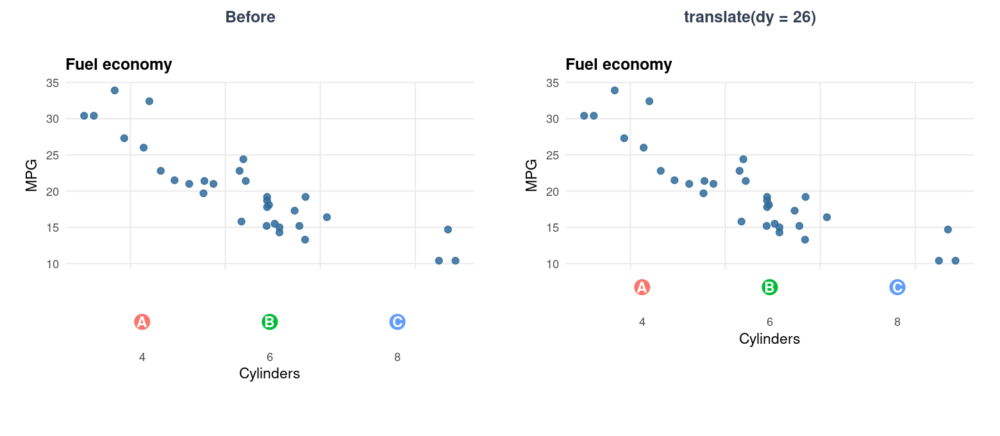
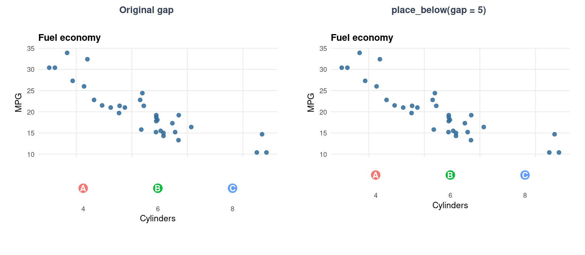
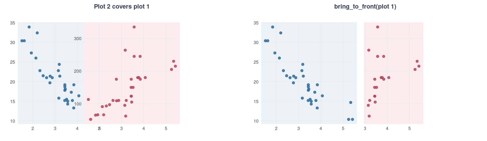
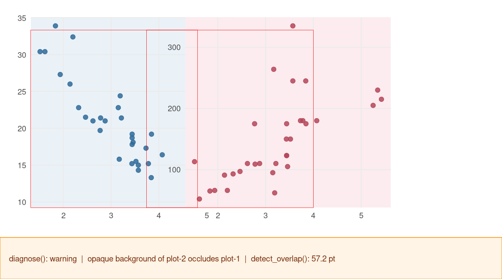
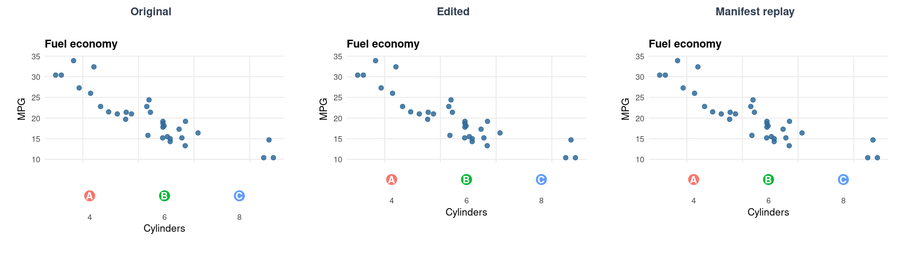
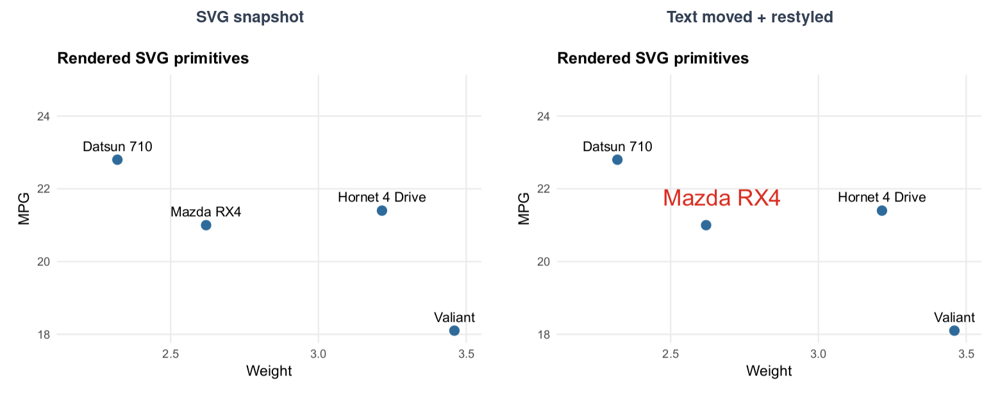
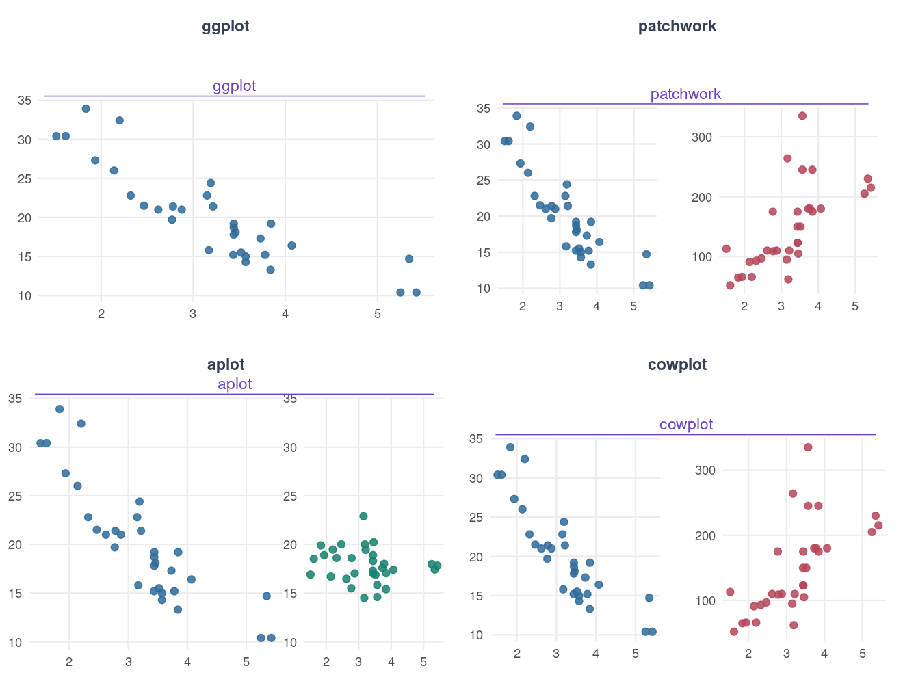

# Incantation

**Agent-native figure layout and post-processing**

[](https://www.r-project.org/)
[](DESCRIPTION)
[](LICENSE)

[Quick start](#30-second-quick-start) · [Features](#features) · [Backends](#backends) · [API reference](#api-reference)

<br clear="right">



Incantation handles the final stages of publication graphics: the figure is largely correct, but a subplot needs a slight upward move,
two panels need precise alignment, a title line needs to span plots, or an edit needs an overflow check. It has two layers:

- `inc_scene`: edit plots, panels, titles, axes and decorations after layout.
- `inc_svg`: directly edit text, points, lines and paths in final SVGs.

Supports ggplot2, patchwork, aplot, cowplot and raw gtable.

## Installation

```r
# Development version
pak::pak("Vinnish-A/Incantation")
```

## 30-second quick start

```r
library(incantation)
library(ggplot2)
library(patchwork)

p1 = ggplot(mtcars, aes(wt, mpg)) + geom_point()
p2 = ggplot(mtcars, aes(wt, hp)) + geom_point()
p = p1 / p2

scene = incant(p, width = 7, height = 6)

edited = scene |>
  select_plot(2) |>
  translate(dy = 18, unit = "pt")

bbox(edited, 2)
diagnose(edited)
ggsave_incant(edited, "edited.svg")
```

width and height are required. All measurements bind to an explicit output device, preventing the same pt displacement
from producing unpredictable results on different canvases.

## Features

### 1. Inspect and measure layouts

incant() lets the original plotting backend finish layout, then builds a stable element registry.
inspect(), bbox() and gap() return device coordinates usable directly for decisions and automation.



```r
scene = incant(p, width = 8, height = 6)

inspect(scene)                 # All addressable elements and bboxes
bbox(scene, 1)                # Plot 1 panel bounds in pt
gap(scene, 2, 1)              # Signed distance between two panels
canvas_size(scene)            # Fixed canvas dimensions
render(scene, debug = TRUE)   # Red outlines around plot panels
```

Helpers: plot_label() checks subplot indices; is_empty_element() identifies spacers.

### 2. Select and translate elements

Selectors accept explicit plot indices, semantic roles or stable IDs; empty and ambiguous selections raise errors.
translate() changes only final drawing positions, without recalculating patchwork row heights, column widths or sibling positions.



```r
edited = scene |>
  select_plot(2) |>
  translate(dy = 26, unit = "pt", clip = "off")
```

Available selectors:

```r
select_plot(scene, 2)
select_panel(scene, 2)
select_role(scene, "title", plot = 1)
select_id(scene, "plot-2/axis-l")
selection_spec(select_plot(scene, 2))
```

### 3. Declare spacing and alignment relationships

To preserve physical spacing across device sizes, use semantic constraints rather than one-off
displacements. Constraints resolve against current geometry during rendering or manifest replay.



```r
edited = scene |>
  place_below(2, 1, gap = 5, unit = "pt")

edited = scene |>
  align_top(2, 1) |>
  align_left(2, 1)
```

Related functions: place_above(), align_top(), align_bottom(), align_left(),
align_right().

### 4. Adjust drawing order

Overlap is not necessarily wrong, but objects need the correct z-order. Reordering still leaves layout allocation unchanged.



```r
overlapped = incant(p1 + p2, width = 7, height = 4) |>
  select_plot(2) |>
  translate(dx = -105, include_background = TRUE)

front = overlapped |>
  select_plot(1) |>
  bring_to_front()

back = overlapped |>
  select_plot(2) |>
  send_to_back()
```

### 5. Add titles and decorative lines across subplots

decorate_group() derives lines and titles from final panel geometry, supporting four sides, independent endpoint
trimming, title alignment and absolute/semantic spans.


```r
p3 = ggplot(mtcars, aes(wt, qsec)) + geom_point()

decorated = incant(p1 + p2 + p3, width = 11, height = 4) |>
  decorate_group(
    plots = 1:3,
    title = "Post-layout group decoration",
    side = "top",
    trim = c(6, 10),
    gap = 3,
    id = "group-a"
  )
```

The entire decoration, line and title are first-class elements available for further editing:

```r
decorated |>
  select_id("group-a/title") |>
  translate(dx = 4, dy = -1)
```

### 6. Diagnose overflow, occlusion and overlap

diagnose() returns machine-readable status and issues; detect_overlap() returns overlapping objects,
directions and overlap amounts. Both fit a visual agent’s inspect–edit–review loop.



```r
diagnose(overlapped)
# $status
# [1] "warning"

detect_overlap(overlapped)
#         a      b overlap_pt       axis
# 1  plot-1 plot-2       44.1 horizontal
```

### 7. Save and replay structured operations

Scenes store operations rather than unauditable temporary grobs. Semantic constraints remeasure on fresh scenes,
so editing code and original plotting code can be maintained separately.



```r
write_incantation(edited, "edit.json")

fresh = incant(p, width = 7, height = 6)
replayed = apply_incantation(fresh, "edit.json")

as_manifest(replayed)
```

### 8. Edit final SVG elements

as_svg() freezes final rendering as inc_svg. Subsequent selection/editing depends only on SVG, without access to
ggplot layers or original data.



```r
svg = scene |>
  as_svg()

edited_svg = svg |>
  select_svg_text("Mazda RX4") |>
  svg_translate(dx = 12, dy = 8) |>
  svg_style(fill = "#D92D20", font_size = 17)

verify_svg(svg, edited_svg)
write_svg(edited_svg, "edited.svg")
```

SVG selectors: select_svg_id(), select_svg_text(), select_svg_at(),
select_svg_bbox().

SVG transforms: svg_translate(), svg_scale(), svg_rotate(), svg_style(),
svg_hide(), svg_zorder(). svg_manifest() inspects all final elements.

### 9. Render and save

```r
as_gtable(scene)                         # Return the edited gtable
render(scene, debug = TRUE)              # Drawable gtable with optional debug bounds
draw(scene)                              # Draw on the current device
ggsave_incant(scene, "figure.png")       # png / pdf / svg
```

ggsave_incant() rejects output dimensions differing from the scene. Absolute offsets tuned on a 7 × 6 inch canvas
cannot silently apply to another size.

## Backends

All backends share selection, measurement, transformation, decoration and manifest APIs.



| Input | Behavior |
|---|---|
| ggplot | One editable plot |
| patchwork | Ordinary, nested, faceted and inset compositions |
| aplot | Preserves user-facing main/inset indices without exposing internal spacers |
| cowplot | Recovers each subplot from GeomDrawGrob viewports |
| raw gtable | Identifies ggplot, cowplot or patchwork structure |

Cowplot has no independent subplot layout cells, so decoration layout_outer uses subplot viewport boundaries.
aplot converted to raw gtable no longer retains the $layout needed to recover user-facing indices; pass the
original aplot object to incant() instead.

## Core constraints

- **Frozen Layout**: edits do not change canvas, panel dimensions, layout tracks or sibling positions.
- **Device binding**: translate() and absolute spans bind to scene dimensions; semantic constraints recompute across sizes.
- **Fixed canvas**: diagnose() reports insufficient decoration space without expanding the canvas.
- **Explicit selection**: missing, empty or ambiguous targets fail immediately.
- **SVG snapshot identity**: SVG manifests bind to source_hash, without promising element matching across different snapshots.

## API reference

| Module | Functions |
|---|---|
| Scene | `incant()` |
| Inspection | `inspect()`, `bbox()`, `gap()`, `canvas_size()`, `plot_label()`, `is_empty_element()` |
| Selection | `select_plot()`, `select_panel()`, `select_role()`, `select_id()`, `selection_spec()` |
| Transformation | `translate()`, `place_below()`, `place_above()`, `align_*()` |
| Drawing order | `bring_to_front()`, `send_to_back()` |
| Decoration | `decorate_group()` |
| Diagnostics | `diagnose()`, `detect_overlap()` |
| Rendering | `as_gtable()`, `render()`, `draw()`, `ggsave_incant()` |
| Operation records | `as_manifest()`, `write_incantation()`, `apply_incantation()` |
| SVG | `as_svg()`, `svg_manifest()`, `select_svg_*()`, `svg_*()`, `verify_svg()`, `write_svg()` |

## Development checks

```r
devtools::test()
devtools::check()
```

All feature illustrations in this README are generated by [dev/readme-figures.R](dev/readme-figures.R) using current package code,
not manually drawn mockups.
